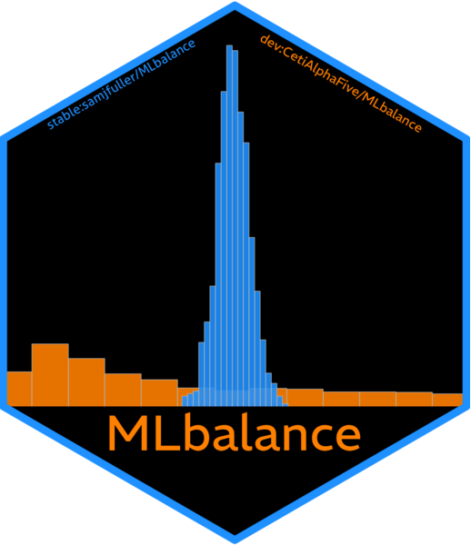
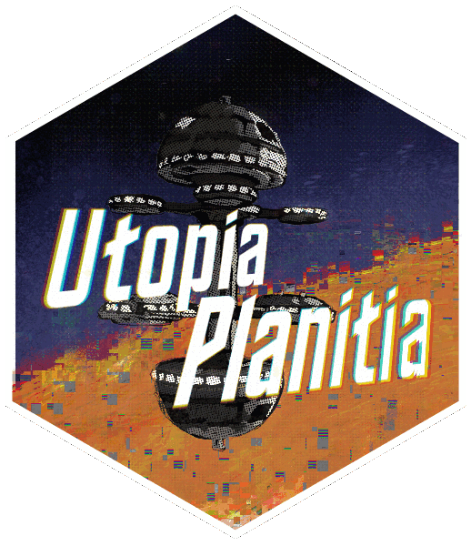

::: headshot-col
{.headshot}
:::

::: bio

Hello there! I am a political scientist and research fellow at the [Mercatus Center](https://www.mercatus.org/) at George Mason University.

My research bridges American political institutions, statistical methodology, and democratic behavior. A central focus is oversight and lawmaking capacity in what I dub the "Legislative State," a network of understudied people and institutions that support Congress.

Additionally, I teach a graduate-level topical workshop on [causal machine learning](https://samjfuller.com/content/ICPSR_Causal_Machine_Learning_Syllabus_2025.pdf) methods at the Inter-university Consortium for Political & Social Research (ICPSR) at the University of Michigan.

I hold a Ph.D. in [Political Science](https://ps.ucdavis.edu/) from the [University of California, Davis](https://www.ucdavis.edu/) with subfields in methods and American politics. I also received a B.A. in Economics and Political Science from George Washington University.

Before graduate school, I was an economic policy research analyst at the [Bipartisan Policy Center](https://bipartisanpolicy.org/). At BPC, I contributed to research on the [federal budget](https://bipartisanpolicy.org/wp-content/uploads/2019/09/PGPF-Bipartisan-Policy-Center-Solutions-Initiative-2019-Report.pdf), [debt limit](https://bipartisanpolicy.org/download/?file=/wp-content/uploads/2019/03/Debt-Limit-Analysis-Everything-You-Need-to-Know-March-2019.pdf), [Social Security and Medicare financing](https://bipartisanpolicy.org/download/?file=/wp-content/uploads/2019/03/A-Guide-to-the-2018-Social-Security-and-Medicare-Trustees-Reports.pdf), and [defense personnel reform](https://www.heritage.org/sites/default/files/2018-09/2019_IndexOfUSMilitaryStrength_CHAPTERS_MISZTAL-RAMETTA.pdf).

:::

::: hex-stickers
   
:::
